# bf2-player-check
Search BF2 players across GameSpy-replacement providers and check their stats

Don't feel like hosting the bot yourself? You can also simply [add it to Discord](https://discord.com/api/oauth2/authorize?client_id=920284644958699530&permissions=0&scope=bot%20applications.commands).

## Commands

### /summary

Show a summary of a player's overall stats (time played, k/d ratio, accuracy etc.).

#### Options

| Name     | Description                                  | Required | Note                                 |
|----------|----------------------------------------------|----------|--------------------------------------|
| provider | BF2 revive provider to pull stats from       | yes      | possible values: `BF2Hub`, `PlayBF2` |
| name     | Name of the player (without clan tag/prefix) | yes      |                                      |

#### Example
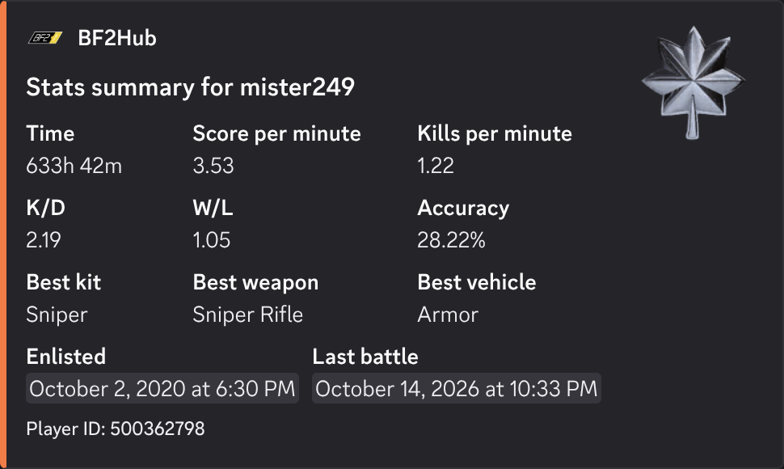

### /search

Find players who's nickname (partially) matches a given name.

#### Options

| Name     | Description                                            | Required | Note                                 |
|----------|--------------------------------------------------------|----------|--------------------------------------|
| provider | BF2 revive provider to search                          | yes      | possible values: `BF2Hub`, `PlayBF2` |
| name     | (Partial) Name of the player (without clan tag/prefix) | yes      |                                      |

#### Example

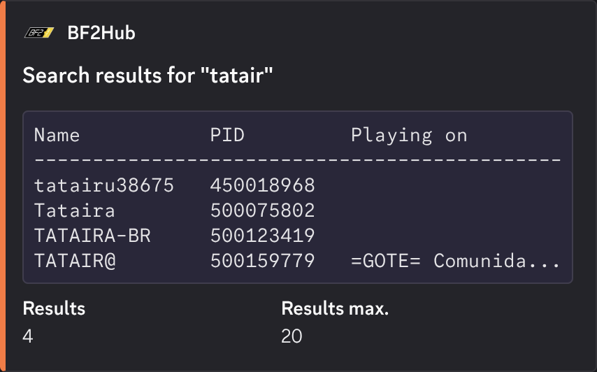

### /kits

Show a player's per-kit stats (time played, k/d ratio).

#### Options

| Name     | Description                                  | Required | Note                                 |
|----------|----------------------------------------------|----------|--------------------------------------|
| provider | BF2 revive provider to pull stats from       | yes      | possible values: `BF2Hub`, `PlayBF2` |
| name     | Name of the player (without clan tag/prefix) | yes      |                                      |

#### Example

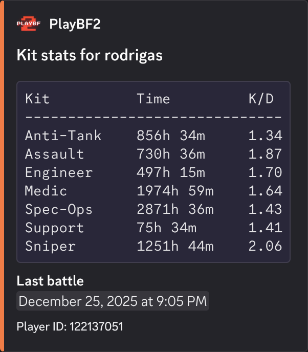

### /weapons

Show a player's per-weapon stats (time played, k/d ratio, accuracy).

#### Options

| Name     | Description                                  | Required | Note                                 |
|----------|----------------------------------------------|----------|--------------------------------------|
| provider | BF2 revive provider to pull stats from       | yes      | possible values: `BF2Hub`, `PlayBF2` |
| name     | Name of the player (without clan tag/prefix) | yes      |                                      |

#### Example

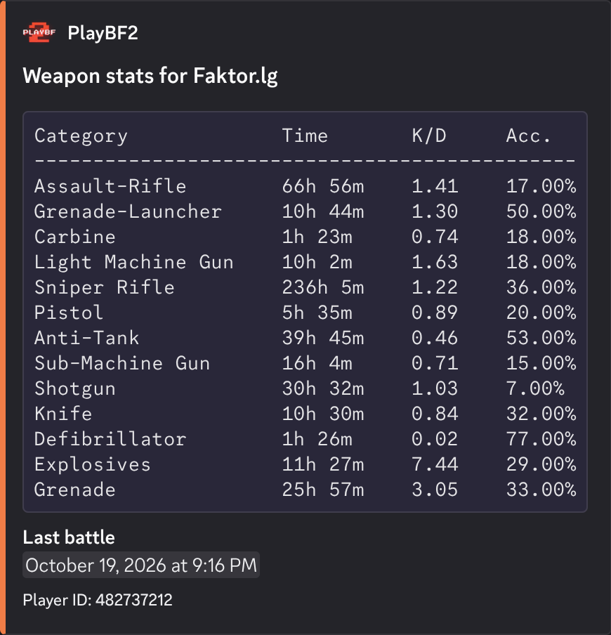

### /vehicles

Show a player's per-vehicle stats (time player, k/d ratio).

#### Options

| Name     | Description                                  | Required | Note                                 |
|----------|----------------------------------------------|----------|--------------------------------------|
| provider | BF2 revive provider to pull stats from       | yes      | possible values: `BF2Hub`, `PlayBF2` |
| name     | Name of the player (without clan tag/prefix) | yes      |                                      |

#### Example

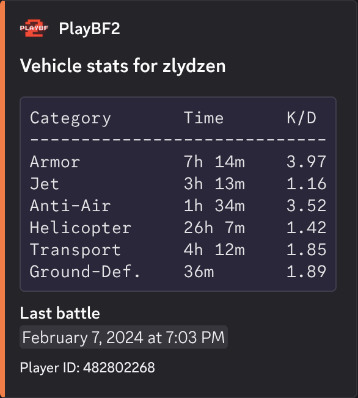

### /maps

Show a player's per-map stats (time played, win rate).

#### Options

| Name     | Description                                  | Required | Note                                 |
|----------|----------------------------------------------|----------|--------------------------------------|
| provider | BF2 revive provider to pull stats from       | yes      | possible values: `BF2Hub`, `PlayBF2` |
| name     | Name of the player (without clan tag/prefix) | yes      |                                      |

#### Example

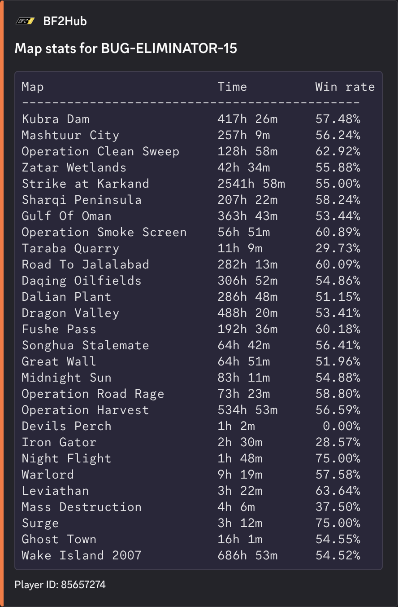

### /leaderboard score

Show a page of the player leaderboard sorted by score.

#### Options

| Name       | Description                            | Required | Note                                                                         |
|------------|----------------------------------------|----------|------------------------------------------------------------------------------|
| provider   | BF2 revive provider to pull stats from | yes      | possible values: `BF2Hub`, `PlayBF2`                                         |
| score-type | Type of score to sort leaderboard by   | no       | possible values: `Overall`, `Rising star`, `Commander`, `Teamwork`, `Combat` |
| page       | Page of the leaderboard to fetch       | no       | minimum value: 1                                                             |

#### Example

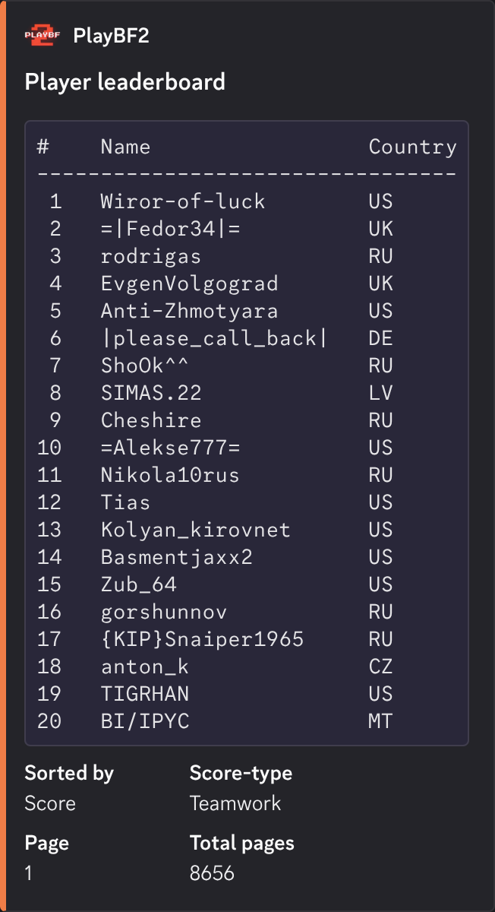

### /leaderboard weapon

Show a page of the player leaderboard sorted by kills in a given weapon category.

#### Options

| Name            | Description                            | Required | Note                                                                                                                                                                                                         |
|-----------------|----------------------------------------|----------|--------------------------------------------------------------------------------------------------------------------------------------------------------------------------------------------------------------|
| provider        | BF2 revive provider to pull stats from | yes      | possible values: `BF2Hub`, `PlayBF2`                                                                                                                                                                         |
| weapon-category | Weapon category to sort leaderboard by | no       | possible values: `Assault-Rifle`, `Grenade-Launcher`, `Carbine`, `Light Machine Gun`, `Sniper Rifle`, `Pistol`, `Anti-Tank`, `Sub-Machine Gun`, `Shotgun`, `Knife`, `Defibrillator`, `Explosives`, `Grenade` |
| page            | Page of the leaderboard to fetch       | no       | minimum value: 1                                                                                                                                                                                             |

#### Example

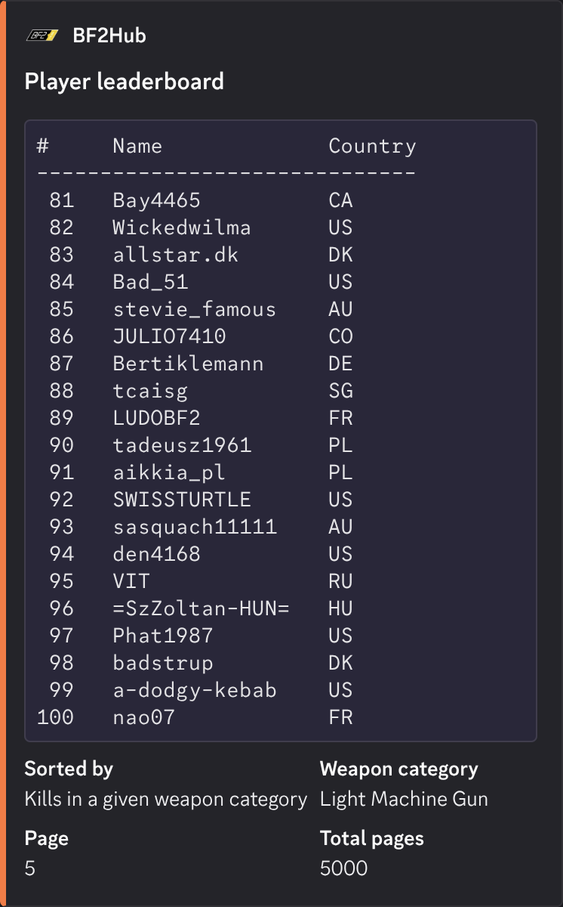

### /leaderboard vehicle

Show a page of the player leaderboard sorted by kills in a given vehicle category.

#### Options

| Name             | Description                             | Required | Note                                                                                  |
|------------------|-----------------------------------------|----------|---------------------------------------------------------------------------------------|
| provider         | BF2 revive provider to pull stats from  | yes      | possible values: `BF2Hub`, `PlayBF2`                                                  |
| vehicle-category | Vehicle category to sort leaderboard by | no       | possible values: `Armor`, `Jet`, `Anti-Air`, `Helicopter`, `Transport`, `Ground-Def.` |
| page             | Page of the leaderboard to fetch        | no       | minimum value: 1                                                                      |

#### Example

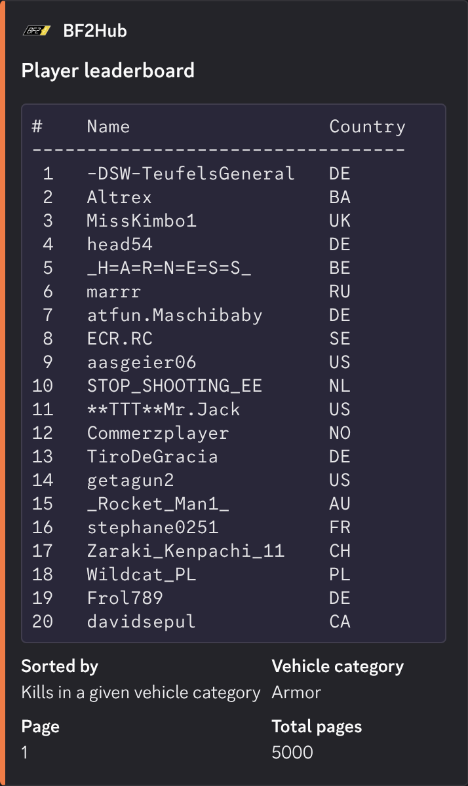

### /leaderboard kit

Show a page of the player leaderboard sorted by kills with a given kit.

#### Options

| Name     | Description                            | Required | Note                                                                                          |
|----------|----------------------------------------|----------|-----------------------------------------------------------------------------------------------|
| provider | BF2 revive provider to pull stats from | yes      | possible values: `BF2Hub`, `PlayBF2`                                                          |
| kit      | Kit to sort leaderboard by             | no       | possible values: `Anti-Tank`, `Assault`, `Engineer`, `Medic`, `Spec-Ops`, `Support`, `Sniper` |
| page     | Page of the leaderboard to fetch       | no       | minimum value: 1                                                                              |

#### Example

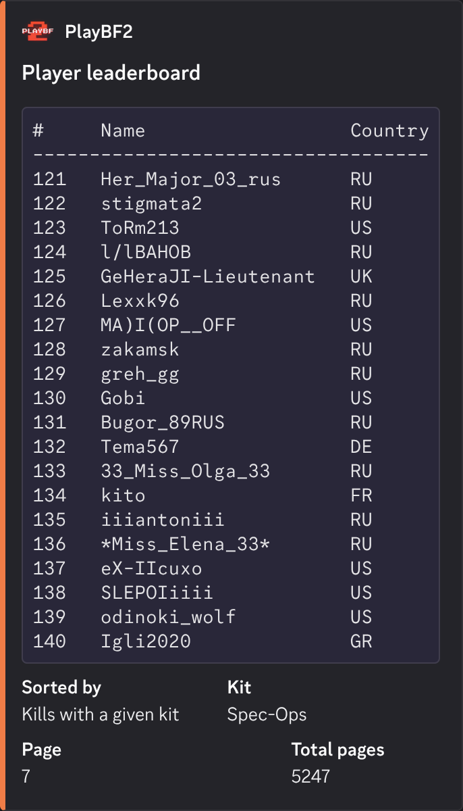

### /activity

Get a player's recent online activity

#### Options

| Name     | Description                                  | Required | Note                                 |
|----------|----------------------------------------------|----------|--------------------------------------|
| provider | BF2 revive provider the player is using      | yes      | possible values: `BF2Hub`, `PlayBF2` |
| name     | Name of the player (without clan tag/prefix) | yes      |                                      |

#### Example

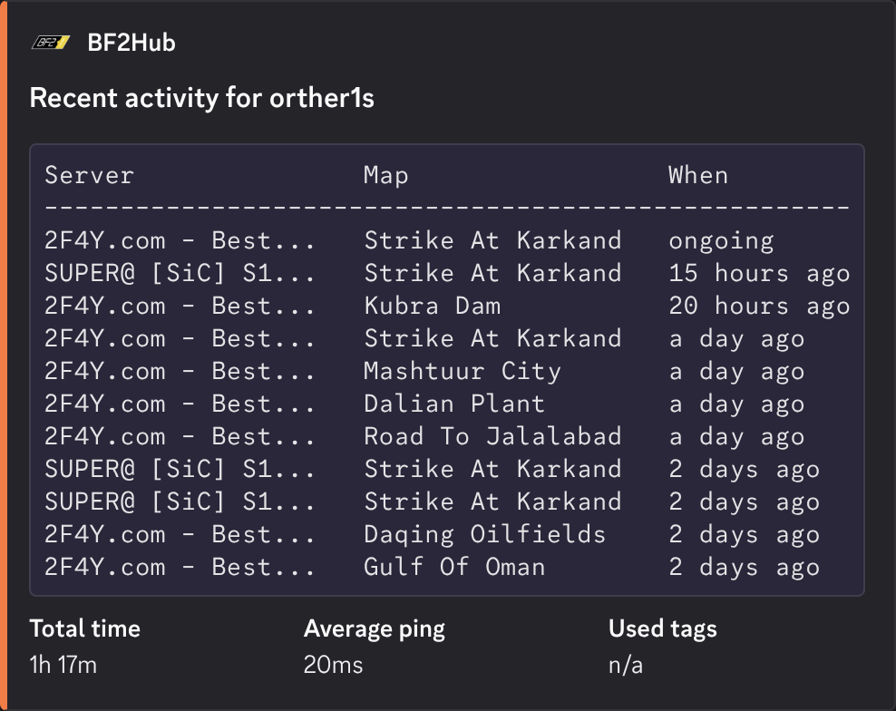
